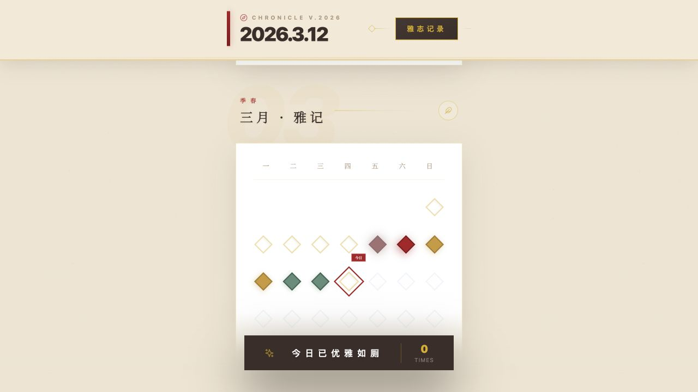

# 雅志

**用一枚菱形，记下今天的如厕次数。**

雅志是一款如厕记录网页原型。纸张底色、金色线条和十二个月的菱形日历，把每天的次数变成一眼能看懂的色阶。

[**在线体验**](https://dounaoo.github.io/yazhi/)

## 怎么用

- 点击日历里的一天，打开当日记录。
- 用加减按钮调整次数，看看日历上的菱形如何随次数变色。
- 点击底部的今日次数，回到演示当天。

当前版本以 2026 年 3 月 12 日为演示当天。页面使用模拟数据，刷新后会恢复初始记录。
